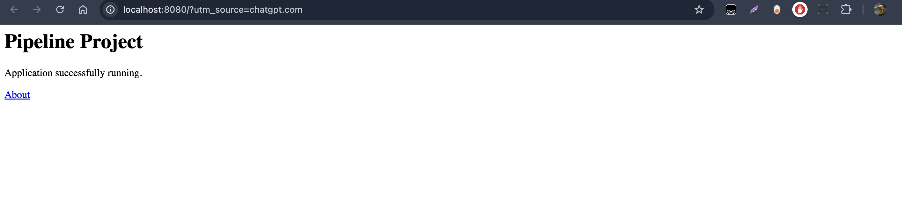
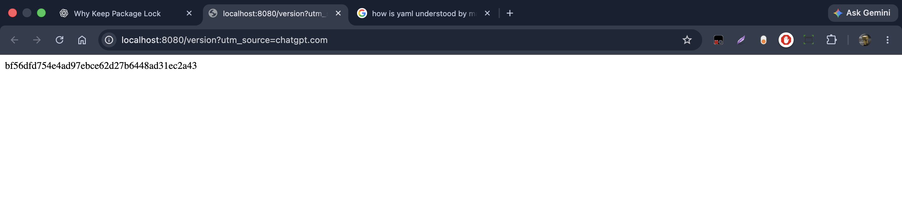

# pipeline_proj

### Description

Creating a git repo and setting up pipeline to see docker environment and how image can be turned into containers and seeing how this can be shown on the webpage. Continually seeing CI/CD pipeline makeup too through 

### What has been done:

CD is being shown through dockerising for now
CI is still not being shown yet. 

## Progress throughout Task 

### Docker Image to Container
From: 
"
  docker run -d \
    --name pipeline-app \
    -p 8080:8080 \
    pipeline_proj:local
"

After the docker building from the image, it created a new localhost in the container as shown here:

### YAML Learning

The idea of YAML is that it is not a markup language which allows it to be readable for us humans

It gets parsed from a YAML parser and then fed into the pipeline machine allowing it to change different settings to run on command

this is where the CI and CD development comes in. 

in the ci-cd.yml file, we made sure to account for 

### Final Result 

got the hash code at the end for the repo! 

The delivery and depoyment worked with the pipeline -> YAML and DOCKER importance.

